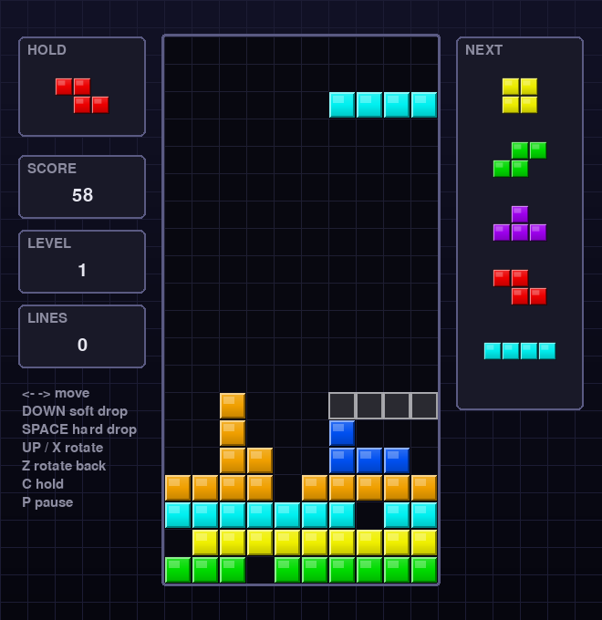

# Python Tetris

pygame으로 만든 데스크톱 테트리스입니다. 개발 전에 작성한 명세는 [docs/PROMPT.md](docs/PROMPT.md)에 있습니다.



## 실행 방법

```bash
pip install -r requirements.txt
python main.py
```

Python 3.10 이상, pygame 2.5 이상이 필요합니다.

## 조작법

| 키 | 동작 |
|---|---|
| ← / → | 좌우 이동 (길게 누르면 자동 반복) |
| ↓ | 소프트 드롭 |
| Space | 하드 드롭 |
| ↑ / X | 시계 방향 회전 |
| Z / Ctrl | 반시계 방향 회전 |
| C / Shift | 홀드 |
| P / Esc | 일시정지 |
| Enter | 시작 / 재시작 |

## 주요 기능

- SRS 회전과 벽차기, 7-bag 랜덤, 고스트 블록, 홀드, 다음 블록 5개 미리보기
- 레벨별 낙하 속도, 락 딜레이(0.5초, 최대 15회 리셋), 줄 삭제 플래시
- 가이드라인 점수 체계 (1/2/3/4줄 = 100/300/500/800 × 레벨, 소프트/하드 드롭 보너스)

## 디렉토리 구조

```
main.py                 진입점
tetris/
  config.py             상수 (크기, 색상, 속도, 점수)
  tetromino.py          블록 모양, 회전, SRS 벽차기
  randomizer.py         7-bag 랜덤 생성기
  board.py              격자, 충돌, 줄 삭제
  game.py               게임 규칙과 상태 (pygame 미사용)
  input_handler.py      키 입력, DAS/ARR
  assets.py             블록/배경 이미지 생성 및 로드
  renderer.py           화면 그리기
  app.py                메인 루프, 화면 상태
assets/images/          코드로 생성한 PNG 이미지
tools/generate_assets.py  이미지 재생성 스크립트
tests/                  pytest 단위 테스트
docs/PROMPT.md          개발 프롬프트
```

## 이미지 재생성

블록과 배경 이미지는 외부 리소스 없이 코드로 그립니다. 색상이나 모양을 바꾼 뒤 다시 만들려면:

```bash
python tools/generate_assets.py
```

이미지가 없으면 게임 시작 시 자동으로 생성됩니다.

## 테스트

```bash
pip install -r requirements-dev.txt
python -m pytest
```
